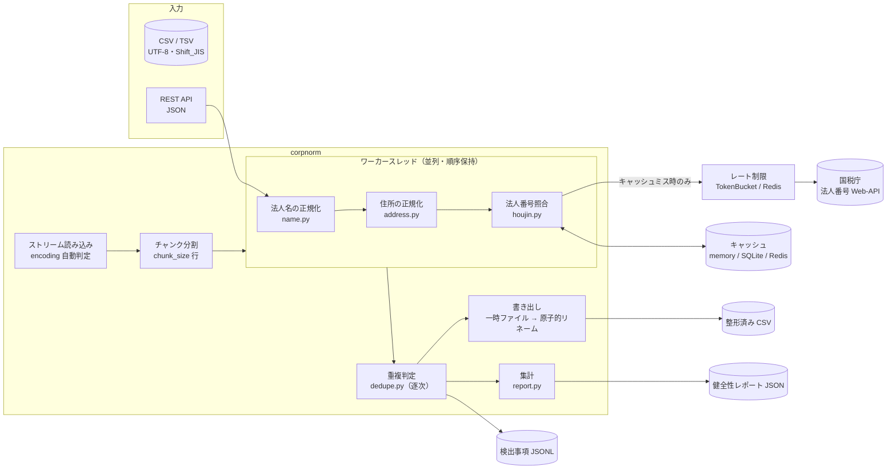

# アーキテクチャと設計判断

## 全体構成

| モジュール | 役割 |
|---|---|
| `text.py` | NFKC・ハイフン類・空白・かなの統一、名寄せキー生成 |
| `name.py` | 法人格（28 種）の検出・展開、前株／後株、支店分離、英文法人格 |
| `address.py` | 漢数字変換、丁目番地号の統一、都道府県／市区町村／町域／番地／建物の分解、郵便番号照合 |
| `postal.py` | 日本郵便 KEN_ALL.csv の辞書（任意） |
| `houjin.py` | 国税庁 API クライアント（キャッシュ・レート制限・再試行）とマッチング |
| `dedupe.py` | ブロッキング付き重複判定 |
| `pipeline.py` | 1 レコードの処理（CLI・API 共通） |
| `batch.py` | CSV ストリーム処理 |
| `report.py` | 健全性レポート |
| `cli.py` / `api/` | 提供形態 |

CLI と REST API は `pipeline.RecordProcessor` を共有するため、同じ入力には常に同じ結果を返します。

## 大容量データ: メモリを一定に保つ

* 入力は `csv.DictReader` で 1 行ずつ読み、`chunk_size`（既定 1,000）行ごとに処理して即座に書き出します。
  メモリに載るのは「1 チャンク分の行」だけで、ファイルサイズに比例しません。
* 文字コード判定は先頭 256KB のみを読みます（マルチバイト文字の途中で切れても誤判定しないよう
  インクリメンタルデコーダーを使用）。
* 集計（レポート）はカウンターのみを保持し、エラー明細は JSONL へ逐次書き出します。
* 出力は同じディレクトリの一時ファイルに書き、成功時にだけ `os.replace` で置き換えます。
  途中で失敗・中断しても、壊れた出力ファイルや前回の成果物の破損は発生しません。

実測（`scripts/benchmark.py`、ピークメモリは子プロセスの最大 RSS）は README を参照してください。
重複判定なしでは 10 万行でも 100 万行でもピークメモリは約 36MB で変わりません。

### 重複判定のメモリと計算量

重複判定は「過去の行」を参照する必要があるため、行データの代わりに **短い比較キーと行番号だけ**
を索引に保持します（1 行あたり数百バイト）。

総当たり比較（O(n²)）を避けるため、次のブロッキングを行います。

| 段階 | 方法 | 計算量 |
|---|---|---|
| 法人番号一致 | ハッシュ索引 | O(1) |
| 完全一致 | (名称キー, 住所キー, 法人格の種類と位置) のハッシュ索引 | O(1) |
| あいまい一致 | 都道府県 × 名称キーの 1〜2 文字目／3〜4 文字目 のブロック内のみ比較 | O(ブロック上限) |

* 2 種類のブロックキーのどちらかが一致すれば比較対象になるため、先頭付近の 1 文字の誤字でも取りこぼしません。
* 末尾（「商事」「工業」など）は値が偏りブロックが肥大化するため、キーに使いません。
* 各ブロックは直近 `max_block_size`（既定 1,000）件のリングバッファで、偏ったデータでも 1 行あたりの比較回数に上限があります。
* 比較は「名称だけで閾値に届く候補」を先に絞り込み（`rapidfuzz` があれば C++ 側で一括計算）、
  残った少数だけを住所込みで採点します。`rapidfuzz` の有無で結果は変わりません（CI で両方を検証）。
* 「株式会社山田商事」と「山田商事株式会社」は別法人でありうるため、法人格の種類・位置が異なる組は
  完全一致として扱わず、類似度に 0.95 を掛けた「あいまい一致」として報告します。

## 国税庁 API: キャッシュとレート制限

呼び出しは必ず **キャッシュ → レート制限 → HTTP（再試行）** の順に通ります。

* **キャッシュキー**: エンドポイントとクエリの SHA-256。ヒットすれば API を呼びません。
  * 該当ありは 7 日、該当なし（ネガティブキャッシュ）は 1 日で失効（`--cache-ttl`）。
  * `sqlite:///` はバッチの再実行（夜間バッチの再処理・差分処理）で効果が大きく、
    `redis://` は API サーバーの複数ワーカー・複数コンテナで共有できます。
  * キャッシュ障害（Redis 停止など）は警告ログのみで処理を継続します（キャッシュミス扱い）。
* **レート制限**: プロセス内はトークンバケット、Redis キャッシュ利用時は Redis の 1 秒窓カウンターで
  全ワーカー合計の呼び出し回数を制限します。
* **再試行**: 429 / 5xx / 通信エラーは指数バックオフ（0.5s, 1s, 2s）で最大 3 回再試行。
  それ以外の 4xx（認証エラー等）は即時に失敗します。
* **安全な XML 解析**: DOCTYPE / ENTITY 宣言を含むレスポンスは解析前に拒否します（XXE・billion laughs 対策）。
* API の照会に失敗した行は `ENRICHMENT_FAILED` として記録し、バッチ全体は止めません。

### マッチング（名寄せ）

1. 法人番号の列があれば、チェックデジットを検証して番号で直接照会します。
2. なければ法人格を除いた名称で部分一致検索します（住所から都道府県コードで絞り込み、0 件なら全国で再検索）。
3. 各候補を採点します。
   * 名称: 名寄せキーの Levenshtein 類似度（法人格の種類違い ×0.85、前株／後株違い ×0.9、閉鎖法人 ×0.9）
   * 住所: 都道府県一致 0.4 + 市区町村一致 0.4 + 町域・番地の類似度 × 0.2
   * 総合: 名称 0.7 + 住所 0.3（住所なしは名称のみ）
4. 最上位が 0.85 以上かつ 2 位との差が 0.05 以上なら `matched`、そうでなければ `ambiguous` として上位候補を返します。
   誤った紐付けを避けるため、確信が持てない場合は自動で決めません。

## 正規化ルールの設計方針

* **地名を壊さない**: 漢数字は「丁目・番地・番・号・地割」の直前とハイフン区切りの中だけ変換します。
  「四日市市」「八王子市」「三番町」「九段北」「十日町市」「三条通」は変換しません。
* **最短一致の罠**: 「四日市市」「市川市」「町田市」「蒲郡市」「大和郡山市」「玉村町」など、
  単純な正規表現で誤分割する市区町村名は明示的に先に照合します。KEN_ALL 辞書を指定すると
  全市区町村の最長一致に切り替わります。
* **曖昧なものは推測しない**: 「中央区」「府中市」「伊達市」のように複数の都道府県に存在する名称からは
  都道府県を補完せず、郵便番号がある場合にだけ補完します。
* **ルールはデータとして持つ**: 法人格・都道府県・郵便番号上位桁・市区町村の表はコードから分離し、
  テストで網羅的に検証しています。

## 郵便番号の整合性チェック

| 辞書 | 検証内容 |
|---|---|
| なし（既定） | 郵便番号の上位 3 桁 → 都道府県（組み込み表）と住所の都道府県を照合 |
| `--postal-dict KEN_ALL.csv` | 郵便番号 → 都道府県・市区町村を照合、未登録番号の検出、市区町村の最長一致・都道府県補完 |

KEN_ALL.csv は日本郵便が公開している郵便番号データ（Shift_JIS / UTF-8 版の双方に対応）です。
約 12 万行をストリームで読み込み、文字列はインターン化してメモリを抑えます。
